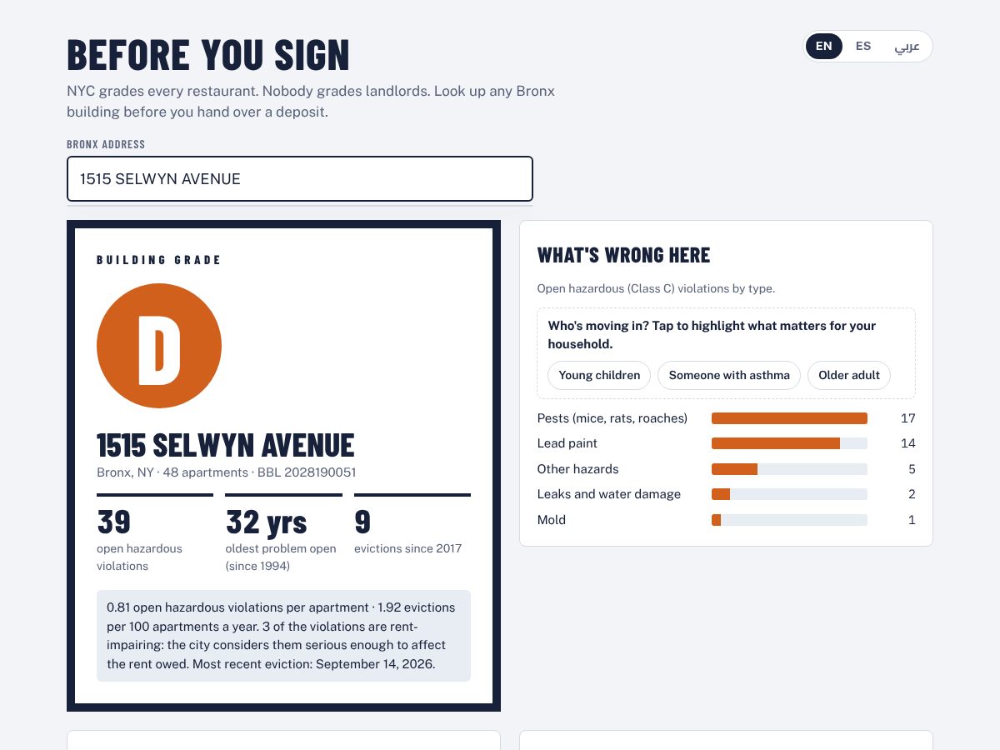
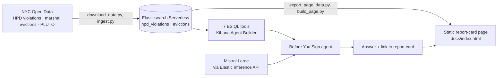
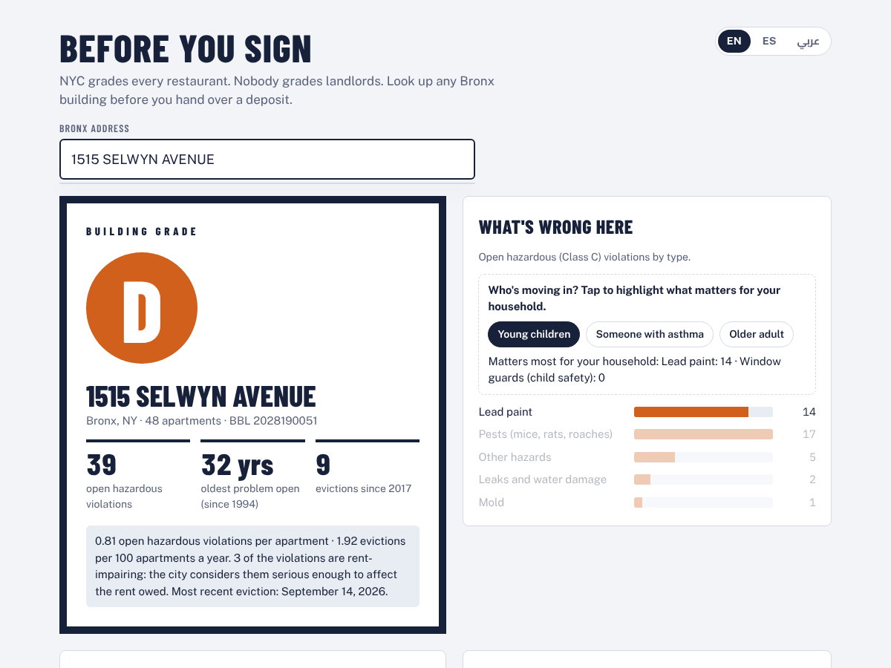
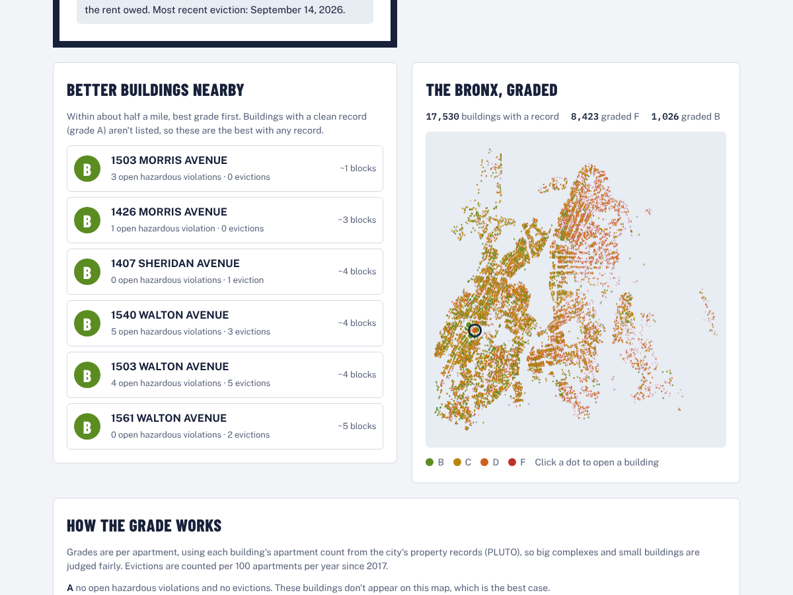
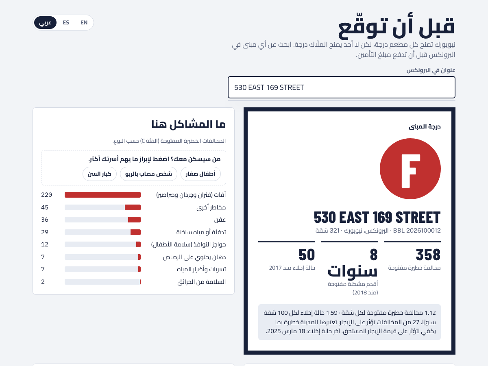
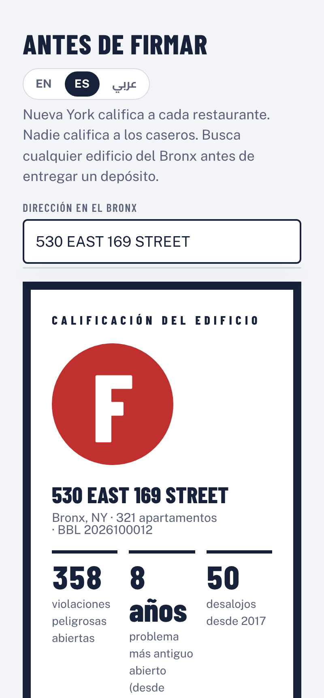

# Before You Sign

**NYC grades every restaurant. Nobody grades landlords.**

Before You Sign grades New York apartment buildings A to F from official city records, starting with the Bronx (17,530 buildings). Ask about an address, or paste a rental listing, and an Elastic Agent Builder agent running on Mistral tells you what the city knows about the building: in plain words, in your language, with better buildings nearby.

Built at the **Elastic × Mistral AI Agents Hack Night** (NYC, October 7, 2026).



## What it does

- **Grades any building.** "I'm thinking of renting at 530 East 169th St. I have a 2 year old. Should I sign?" returns grade F, the numbers behind it, the three worst open problems in everyday words, and questions to ask the landlord.
- **Checks rental listings.** Paste a listing and every marketing claim is checked against the city records: **TRUE**, **FALSE** or **CAN'T CHECK**, each with the exact number.
- **Puts your household first.** Mention kids, asthma or an older parent, and the matching risks lead the answer: lead paint and window guards, mold and pests, or heat and fire safety.
- **Finds better buildings nearby.** For C, D and F buildings, it lists better-graded buildings within half a mile.
- **Answers in the renter's language.** English, Spanish and Arabic (typed Egyptian Arabic works too) for the agent and the report-card page.
- **Links to a visual report card.** Every answer ends with a link to a static page with the grade, violations by type, a household filter, better buildings nearby, and a map of every graded building.

### Example: a listing check

> Check this listing: STUNNING RENOVATED 2BR at 1515 Selwyn Ave, Bronx! Pest-free, well-maintained building with great heat all winter. Lead-safe and perfect for families. Sunny and steps from the train. Responsive management. Won't last!

Agent output (excerpt):

> **Listing check: 1515 SELWYN AVENUE · Grade: D**
>
> **FALSE** "Pest-free." 17 open pest violations. The pests are thriving.<br>
> **TRUE** "Great heat all winter." 0 open heat violations. Credit where due.<br>
> **FALSE** "Lead-safe." 14 open lead paint violations. The paint is not safe.<br>
> **FALSE** "Responsive management." 9 evictions since 2017, and the oldest open violation dates to 1994. The management is not responsive.<br>
> **CAN'T CHECK** "Sunny." The city does not inspect sunlight.
>
> **Better options nearby:** B · 1503 Morris Avenue (1 block away) · B · 1426 Morris Avenue (3 blocks) · B · 1407 Sheridan Avenue (4 blocks)
>
> **Bottom line:** The heat works. The rest is a legal liability.

## How it works



**Elastic does the math. Mistral does the talking.** Every grade, count, verdict and distance is computed in ES|QL. Mistral picks the tools, explains the results and writes the answer in the renter's language. It never computes a number.

That split came from testing. Early on, Mistral would copy a building's coordinates into the nearby-buildings tool slightly wrong and search the wrong neighborhood, and it sometimes judged a listing claim against the wrong number. So the tools now take only a building ID (BBL) and do everything else inside Elasticsearch:

- **Grading** runs one ES|QL query across both indices (`FROM hpd_violations, evictions METADATA _index`) and grades per apartment.
- **Better nearby** looks up the building's own location and grade with `INLINE STATS` in the same query, then runs an `ST_DISTANCE` geo search over every building within 800 m and grades each one on the fly.
- **Listing claims** are categorized from violation descriptions, and the TRUE/FALSE verdicts are computed in ES|QL. The agent's instructions say to copy the verdicts, never change them.

### The grade

Grades are per apartment, using each building's residential unit count from PLUTO, so a 300-unit complex isn't punished for being big. Evictions are counted per 100 apartments per year since January 2017.

| Grade | Rule |
|---|---|
| **F** | 1+ open hazardous violations per apartment, or 3+ evictions per 100 apartments a year |
| **D** | 0.5+ violations per apartment, or 2+ evictions per 100 apartments a year |
| **C** | 0.2+ violations per apartment, 1+ evictions per 100 apartments a year, or any hazardous violation open more than 2 years |
| **B** | Some records, but low rates |
| **A** | No open hazardous violations and no evictions |

Buildings whose apartment count isn't in PLUTO (278 of them) are shown as not graded.

### Agent tools (`elastic/tools/`)

| Tool | What it does |
|---|---|
| `bys_find_building` | Full-text address match (`MATCH`) to find the building and its BBL |
| `bys_grade_building` | Per-apartment grade, rates, rent-impairing violations, oldest open problem, last eviction |
| `bys_risk_breakdown` | Open violations by category: pests, lead paint, mold, heat, fire safety, window guards, leaks |
| `bys_violation_examples` | The 12 oldest open violations with the city's descriptions, which the agent rewrites as the "3 worst problems" in plain words |
| `bys_better_nearby` | Better-graded buildings within 800 m (geo distance + `INLINE STATS`) |
| `bys_claim_check` | Deterministic TRUE/FALSE verdicts for common listing claims |
| `bys_worst_buildings` | Worst buildings by violations per apartment, for charts via `platform.core.create_visualization` |

The agent's full instructions are in [`elastic/agent.json`](elastic/agent.json), and each query is also saved as a plain `.esql` file in [`elastic/esql/`](elastic/esql/).

## Screenshots

| Household filter | Better buildings nearby and the map |
|---|---|
|  |  |

| Arabic | Spanish, on a phone |
|---|---|
|  |  |

## Data

All from [NYC Open Data](https://opendata.cityofnewyork.us/), downloaded October 7, 2026:

| Dataset | Filter | Rows |
|---|---|---|
| [HPD Housing Maintenance Code Violations](https://data.cityofnewyork.us/d/wvxf-dwi5) | Bronx, Class C (immediately hazardous), open | 167,819 |
| [Evictions](https://data.cityofnewyork.us/d/6z8x-wfk4) | Bronx, residential, executed by city marshals (records start January 2017) | 40,754 |
| [Primary Land Use Tax Lot Output (PLUTO)](https://data.cityofnewyork.us/d/64uk-42ks) | Bronx, residential unit counts | 89,362 |

## Run it yourself

You need an Elastic Cloud Serverless project (Elasticsearch + Kibana with Agent Builder), a Mistral API key and Python 3.10+.

```bash
pip install -r requirements.txt
cp .env.example .env                 # fill in your Elastic and Mistral details

python scripts/download_data.py      # NYC Open Data -> data/*.csv (no key needed)
python scripts/ingest.py             # data/*.csv -> Elasticsearch indices
python scripts/setup_inference.py    # Mistral chat endpoint in the Elastic Inference API
python scripts/setup_agent.py        # ES|QL tools + agent in Kibana Agent Builder

python scripts/setup_agent.py ask "Is 1515 Selwyn Ave in the Bronx a good building?"
python scripts/query.py elastic/esql/bys_grade_building.esql bbl=2028190051

python scripts/export_page_data.py   # refresh the report-card data from Elasticsearch
python scripts/build_page.py         # -> docs/index.html
```

In Kibana, open **Agents → Before You Sign** and choose the `mistral-chat` model. The agent's report-card link is set in `elastic/agent.json` (the `LINK:` paragraph); point it at wherever you host `docs/index.html`, for example GitHub Pages from the `docs/` folder. Deep links look like `index.html#2028190051-es` (building BBL, then `en`, `es` or `ar`).

## Repo layout

```
elastic/agent.json        agent instructions and tool list
elastic/tools/*.json      Agent Builder tool definitions (ES|QL + parameters)
elastic/esql/*.esql       the same queries as plain files
scripts/                  download, ingest, inference + agent setup, page export and build
web/page_template.html    report-card page source
web/data/                 exported grades and violation categories
docs/index.html           built report-card page (self-contained)
docs/img/                 screenshots
```

## Limitations

- The Bronx only, so far. The same pipeline works for the other boroughs by changing the download filters.
- Only open Class C (immediately hazardous) violations are counted. Closed and less serious violations are ignored.
- Violation categories come from keyword matches on the city's descriptions, so a few are miscategorized.
- No records doesn't guarantee a good building; it means the city has nothing open on file.
- This is information, not legal advice. NYC tenants facing eviction can get free legal help: call 311 and ask for [Right to Counsel](https://www.nyc.gov/site/mayorspeu/resources/right-to-counsel.page).
